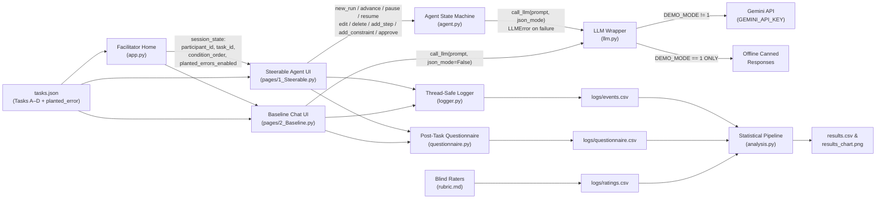

# Submission — Topic 3: Human–Agent Interaction

## Concept Name
**SteerPlan** — *A Plan-First, Confidence-Gated Steerable AI Agent & Within-Subjects HAI Study Platform*

## One-Line Principle
> **Make every multi-step agent decision visible, interruptible, editable, and confidence-gated before it compounds into a final recommendation.**

---

## 1. Design Overview

Standard chat-based AI assistants ("Baseline Chat") operate as opaque, single-shot black boxes: users write a prompt, wait for a monolithic answer, and can only repair errors reactively after wrong assumptions have already shaped the recommendation. **SteerPlan** replaces single-shot generation with a live, editable execution plan:

1. **Plan before acting:** The agent decomposes a constrained research task into 5–6 explicit steps (`agent.new_run`).
2. **One step at a time:** Each rerun advances at most one step (`agent.advance`), streaming intermediate outputs, self-assessed confidence (`1/5`–`5/5`), and concise rationales (`why`) into a two-column workspace.
3. **Steer mid-flight:** At any point, the participant can pause, edit a step description, delete unnecessary steps, insert new steps, or inject new global constraints—automatically preserving valid earlier work while resetting only affected and downstream steps.
4. **Calibrated escalation:** Whenever the agent's step confidence drops below `3/5`, execution halts (`needs_approval`) until the human explicitly approves or edits and reruns the step.
5. **Built-in empirical comparison:** A facilitator console (`app.py`) launches counterbalanced within-subjects sessions comparing **SteerPlan** (`pages/1_Steerable.py`) against a plain **Baseline Chat** (`pages/2_Baseline.py`), backed by structured telemetry (`logger.py`), post-task questionnaires (`questionnaire.py`), blind grading rubrics (`rubric.md`), and a statistical pipeline (`analysis.py`).

---

## 2. Four Pillars of Human–Agent Interaction

### Pillar 1: Interaction Design
Designing a workspace where human attention stays focused on decision points rather than raw prompt engineering.

| Capability / Feature | Implementation Details | Mapped Files |
| :--- | :--- | :--- |
| **Two-column live workspace** | Left column shows the ordered **Live Plan** cards; right column shows the latest non-deleted **Step Output & Result** and final synthesis panel. | `pages/1_Steerable.py` |
| **Compact steering toolbar** | Single top action bar exposes **Pause / Resume**, **Add step** popover (with insertion point selector), **Add constraint** input, and visual constraint chips. | `pages/1_Steerable.py` |
| **Scannable step-status badges** | Color-coded status pills distinguish `pending`, `running` (neutral badge), `done`, `needs_approval`, `edited`, and `deleted` without cluttering descriptions. | `pages/1_Steerable.py` |
| **Inline edit-and-rerun flow** | Clicking **Edit** or **Edit-and-rerun** opens an in-place text area directly inside the affected step card, saving and auto-resuming in one action. | `pages/1_Steerable.py` |
| **Facilitator–participant separation** | Counterbalancing (`steerable_first` vs. `baseline_first`), task selection (`A`–`D`), and planted-error toggles live strictly on the Facilitator Home screen, hidden from participant UIs. | `app.py`, `tasks.json` |
| **Matched baseline & post-task flow** | Plain single-turn chat interface with identical task instructions and post-task NASA-TLX / trust / error-detection form for fair comparison. | `pages/2_Baseline.py`, `questionnaire.py` |

### Pillar 2: Trust and Transparency
Calibrating user trust—preventing both blind over-reliance and unjustified distrust—by exposing uncertainty, reasoning, and system boundaries.

| Capability / Feature | Implementation Details | Mapped Files |
| :--- | :--- | :--- |
| **Explicit 1–5 confidence signaling** | Every executed step displays an explicit `f"{conf}/5"` confidence pill alongside its status pill. | `agent.py`, `pages/1_Steerable.py` |
| **Visible step rationales (`why`)** | Each step's short `why` explanation is rendered directly on the step card for **both** `done` and `needs_approval` states, clarifying why the agent proceeded or paused for review. | `agent.py`, `pages/1_Steerable.py` |
| **Intermediate output inspection** | Users read step outputs as they complete rather than waiting for a final black-box paragraph, enabling early spotting of bad specs or prices. | `pages/1_Steerable.py` |
| **Honest mode & error boundaries** | When `DEMO_MODE=1`, a prominent **`DEMO MODE`** warning banner is displayed and `demo=true` is logged in `session_start`. Outside `DEMO_MODE=1`, canned demo text is never returned; failures raise `LLMError`, surface an explicit error banner with a **Retry** button, and log `agent_error`. | `llm.py`, `agent.py`, `pages/1_Steerable.py`, `logger.py` |
| **Planted-error trust probe** | Tasks `A` and `C` optionally inject a plausible false spec/price at `step_index=1` (setting `state["planted_injected"] = True` and logging `planted_error_injected` once) to objectively measure whether transparency helps users detect and correct factual errors. | `tasks.json`, `agent.py`, `pages/1_Steerable.py`, `pages/2_Baseline.py`, `rubric.md` |

### Pillar 3: Human-in-the-Loop Control
Ensuring the human remains the authority over plan structure, constraints, risk thresholds, and recovery.

| Capability / Feature | Implementation Details | Mapped Files |
| :--- | :--- | :--- |
| **Confidence-gated approval halt** | Any step with `confidence < 3` transitions to `needs_approval`; both `agent.advance()` and the UI auto-advance loop halt completely until the user clicks **Approve** (`agent.approve`) or **Edit-and-rerun** (`agent.edit_step`). | `agent.py`, `pages/1_Steerable.py` |
| **Pause & Resume** | `agent.pause()` / `agent.resume()` toggle `state["paused"]`; while paused, `advance()` returns immediately without executing steps or mutating flags. | `agent.py`, `pages/1_Steerable.py` |
| **Step editing with selective recomputation** | `agent.edit_step()` marks the edited step `edited`, clears its prior output/confidence/why, resets all subsequent non-deleted steps to `pending`, clears `final_answer`, and preserves all earlier completed step outputs. | `agent.py`, `pages/1_Steerable.py` |
| **Step deletion & insertion** | `agent.delete_step()` marks steps `deleted` (skipped in execution, context forwarding, and synthesis) and resets later steps; `agent.add_step()` inserts a `pending` step after any chosen step (or at the end) and resets later steps. | `agent.py`, `pages/1_Steerable.py` |
| **Dynamic constraint injection** | `agent.add_constraint()` appends unique non-empty constraints, ignores duplicates/blanks without side effects, resets from the first incomplete step (or last completed step if finished), and re-synthesizes under the updated constraint set. | `agent.py`, `pages/1_Steerable.py` |
| **Post-finish re-steering & error recovery** | Mutating the plan after clicking **Finish task** resets `steerable_finished_ui` so the participant reviews the updated answer; clicking **Retry** recovers cleanly from failed plan generation, step execution, or final synthesis. | `pages/1_Steerable.py`, `agent.py` |

### Pillar 4: Agent Behavior Modeling
Representing agent execution as a deterministic, inspectable state machine rather than an unconstrained loop.

| Capability / Feature | Implementation Details | Mapped Files |
| :--- | :--- | :--- |
| **Explicit state & step schemas** | All execution state lives in a serializable dictionary (`task_text`, `steps`, `constraints`, `paused`, `final_answer`, `planted_error`, `planted_injected`, `error`) with uniform step objects (`id`, `title`, `description`, `status`, `output`, `confidence`, `why`). | `agent.py`, `CONTRACT.md` |
| **Single-step, non-looping execution** | `agent.advance(state)` selects at most one `("pending", "edited")` step via `next(...)`, passes prior `done` outputs and active constraints into the prompt, updates that step, and only invokes `_maybe_finalize(state)` once every non-deleted step is `done`. | `agent.py` |
| **Dependency-preserving cascade (`_reset_from`)** | Shared `_reset_from(steps, start_idx)` helper guarantees consistent invalidation across `edit_step`, `delete_step`, `add_step`, and `add_constraint`, always preserving `steps[:start_idx]` and skipping `deleted` steps. | `agent.py` |
| **Strict JSON contract & error isolation** | `llm.call_llm()` strips markdown fences, validates JSON syntax and top-level type (object for steps; list or `{"steps": [...]}` for plans), retries once on parse/type failure, and raises `LLMError` on persistent failure or API/key errors. `agent.py` validates required fields (`output`, `confidence`, `why`; `title`, `description`) and catches `LLMError` into `state["error"]`. | `llm.py`, `agent.py` |
| **Controlled one-time error injection** | `_planted_done` ensures a configured `planted_error` is appended once at `step_index` and propagated via `Previous step outputs:` / `Completed step outputs:`, while allowing user steering (`edit_step`) to cleanly remove it on re-run. | `agent.py`, `tasks.json` |
| **Contract-aligned mock scaffold** | `mock_agent.py` preserves the original 10-function mock API untouched for isolated reference, while `pages/1_Steerable.py` runs against the real `agent.py`. | `mock_agent.py`, `CONTRACT.md` |

---

## 3. System Architecture



### Module Map
- **`app.py`** — Facilitator Home: Participant ID entry, parity-based counterbalancing suggestion, Task Variant (`A`–`D`), facilitator-only planted-error toggle, and condition launch buttons.
- **`pages/1_Steerable.py`** — Steerable Agent UI wired to `agent.py`, `logger.py`, and `questionnaire.py`.
- **`pages/2_Baseline.py`** — Plain single-shot Baseline Chat UI wired to `llm.py`, `logger.py`, and `questionnaire.py`.
- **`agent.py`** — Steerable agent state machine (plan creation, single-step advance, confidence gating, selective cascade resets, planted-error injection, error capture).
- **`llm.py`** — Gemini API wrapper with JSON type validation, retry-once, `LLMError` isolation, and strict `DEMO_MODE=1` offline mode.
- **`logger.py`** — Thread-safe CSV event telemetry writer (`logs/events.csv`).
- **`questionnaire.py`** — Post-task NASA-TLX short form, control/understanding/trust ratings, and error-detection form (`logs/questionnaire.csv`).
- **`tasks.json`** — Four India-contextualized student decision tasks (`A`–`D`), two with planted factual errors (`A`, `C`) and two clean controls (`B`, `D`).
- **`rubric.md`** — Five-dimension 1–5 output quality rubric and two-rater blinding/adjudication protocol (`logs/ratings.csv`).
- **`analysis.py`** — Paired Wilcoxon, Cohen's $d_z$, 95% CI, Cohen's $\kappa$, ICC(2,1), synthetic pipeline validator (`--fake`), and grouped bar chart generator.
- **`CONTRACT.md`** — Shared module/API/schema contract reconstructed from the codebase.
- **`mock_agent.py`** — Unmodified temporary mock agent scaffold retained for reference.

---

## 4. How to Run

### Prerequisites & Installation
```powershell
python -m venv .venv
.venv\Scripts\pip install -r requirements.txt
```

### Option A — Live Mode (Gemini API)
```powershell
$env:DEMO_MODE=""
$env:GEMINI_API_KEY="your-gemini-api-key"
# Optional: $env:GEMINI_MODEL="gemini-2.0-flash"
.venv\Scripts\streamlit run app.py
```

### Option B — Offline Demo Mode (Canned Responses, No API Key Needed)
```powershell
$env:DEMO_MODE="1"
.venv\Scripts\streamlit run app.py
```
*(In `DEMO_MODE=1`, the Steerable page displays a visible **`DEMO MODE`** banner and records `demo=true` in `session_start` details in `logs/events.csv`.)*

### Running Analysis
- **Validate the analysis pipeline on synthetic data (`n=10`):**
  ```powershell
  .venv\Scripts\python analysis.py --fake
  ```
- **Analyze real collected logs** (after placing real `logs/events.csv`, `logs/questionnaire.csv`, and blind `logs/ratings.csv`):
  ```powershell
  .venv\Scripts\python analysis.py
  ```

---

## 5. Two-Minute Demo Script

| Time | Screen / Action | What to Point Out to the Audience |
| :--- | :--- | :--- |
| **0:00–0:20** | **Facilitator Home (`app.py`)** — Enter Participant ID `P01`, select Task `A` (*Coding & Study Laptop, INR 65,000*), keep *Enable planted errors* ON, click **1st: Open Steerable Agent**. | Show automatic odd/even counterbalancing (`Steerable → Baseline`), facilitator-only planted-error toggle (invisible to participants), and structured INR task constraints. |
| **0:20–0:45** | **Live Plan & Transparency (`pages/1_Steerable.py`)** — Watch steps `s1` and `s2` execute one step at a time. *(If running offline, note the visible `DEMO MODE` banner.)* | Highlight the two-column layout: 5-step plan on the left, live intermediate outputs on the right, explicit `X/5` confidence pills, and `Why:` rationales. Point out the planted spec error injected into step 2 (`Lenovo IdeaPad Slim 5 weighs 2.4 kg / 4-hour battery`). |
| **0:45–1:15** | **Human-in-the-Loop Control** — Wait for step 3 (`s3`) to halt with **Approval Needed** (`confidence < 3`, e.g., `2/5`). Click **Pause**, add a constraint (e.g., `Prioritize matte display`), and click **Edit** on `s2` to re-verify laptop weight/battery specs, then click **Save & Apply**. | Show three controls in action: (1) low-confidence automatic halt showing `Why:` before approval, (2) selective recomputation preserving `s1`'s output while resetting `s2` (`edited`) and `s3`–`s5` (`pending`), and (3) removal of the planted error when `s2` re-runs. |
| **1:15–1:40** | **Approval, Completion & Questionnaire** — Approve `s3` if prompted, let remaining steps finish, review **Plan completed** final answer, click **Finish task**, and show the embedded post-task questionnaire. | Show end-to-end telemetry capture (`logs/events.csv` with `edit_step`, `add_constraint`, `approved`, `planted_error_injected`) and immediate post-task NASA-TLX + control/trust + error-detection form (`logs/questionnaire.csv`). |
| **1:40–2:00** | **Baseline Contrast & Analysis (`pages/2_Baseline.py` + `analysis.py`)** — Briefly switch to Baseline Chat (single prompt box, single monolithic answer) and display `results_chart.png` / `rubric.md`. | Contrast black-box single-shot chat against SteerPlan's transparent, steerable workflow, and show how blind 2-rater rubric scores and paired Wilcoxon statistics evaluate the interaction. |
